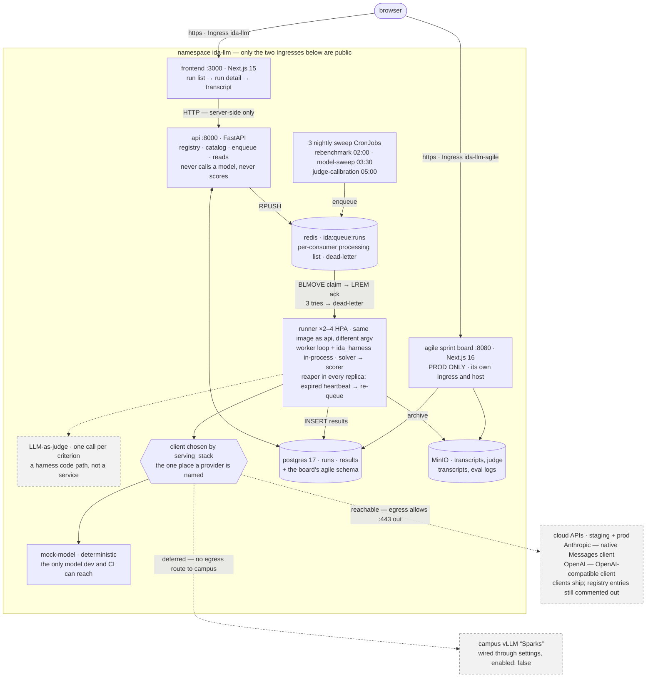
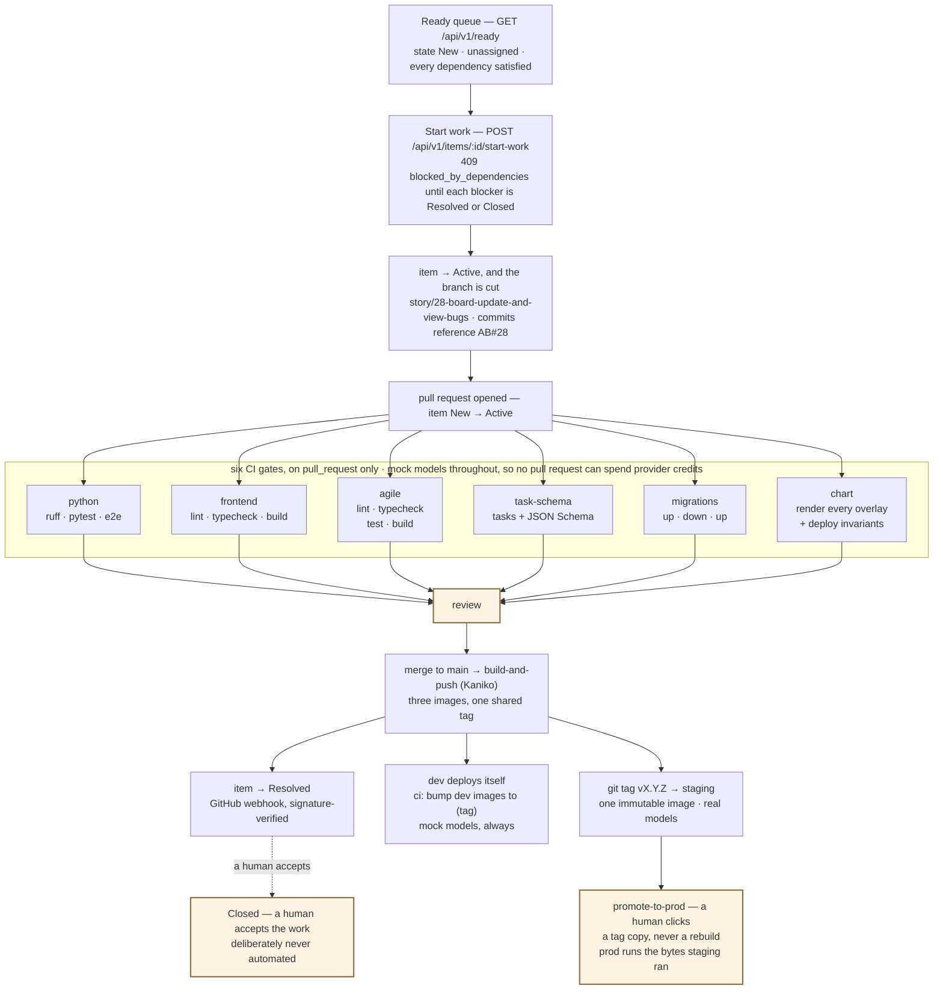

# IDA-LLM

**A benchmarking platform for large language models on non-coding academic
tasks, built to recommend models to university professors — with evidence.**

Two products in one repo (D-3):

1. a **benchmark data platform** that runs tasks against models and stores
   reproducible, citable results;
2. a **recommendation engine** that turns those results into "use model X for
   task Y", where every claim traces back to a specific transcript.

> **Status: the deploy path is live and the walking skeleton has landed.**
>
> The **structure**, the **chart** and the **pipelines** were scaffolded and
> verified end to end. The application is now real: contracts, harness, queue
> worker, API and UI all go end to end against a deterministic mock model. What
> remains is depth, not scaffolding — see **Known gaps** below, each documented
> at the point in the code where it matters.

> **Sprint board:** work items for this project live at
> **<https://ida-agile.capstone.uamishub.com>** (`apps/agile/` — sign in with GitHub;
> access is limited to the `UA-MIS/ida-llm` team).

---

## Quickstart

```bash
make install     # creates .venv/, installs Python packages editable + npm install
make test        # everything that gates a commit — no Docker needed
make dev         # bring up the whole stack in Docker
make tracer      # prove it end to end against the live stack
```

Then open <http://localhost:3000> and fire a run:

```bash
make tracer-manual
```

`make test` needs **Python 3.12 and Node 22+**. `make dev` and `make tracer`
additionally need **Docker**. No API key is required, ever — local dev runs
against a deterministic mock model.

**About the virtualenv.** `make install` creates `.venv/` and installs there.
This is not a preference: Ubuntu 22.04+ and Debian 12+ mark the system
interpreter as externally managed (PEP 668), so `pip install` into it fails
outright. Every `make` target uses `.venv/` automatically — you never have to
activate it. If you manage environments yourself (conda, a devcontainer, CI),
pass `VENV=` to install into whatever interpreter is active:

```bash
make install VENV=      # use the current interpreter instead of .venv/
```

If `python3 -m venv` is missing, `sudo apt install python3-venv`.

**Host ports.** Every port `make dev` publishes is overridable, because 9000
(MinIO) and 5432 (Postgres) are commonly already taken:

```bash
MINIO_PORT=9100 API_PORT=8001 make dev
```

Or without `make`, exactly as CI does it:

```bash
python -m venv .venv && . .venv/bin/activate
pip install -e packages/core -e packages/harness \
            -e services/api -e services/runner -e services/mock-model
pip install -r requirements-dev.txt

cp .env.example .env        # nothing secret in it; fill in what you need

ruff check packages services tools
pytest
python tools/validate_tasks.py

# the mock model endpoint (what CI and dev point at)
PORT=8099 ida-mock-model

cd frontend && npm ci && npm run dev
```

---

## Architecture

A run is a message. The api validates it, writes the `queued` rows and pushes
to Redis; a runner claims it, drives the harness against one model endpoint,
and writes results back. Nothing else calls a model, and nothing else scores.

**Dashed means built but not switched on today** — the judge, the cloud
registry entries and Sparks are all code that ships and configuration that
does not.



### How work reaches production

The board is the queue: an item is pickable only once its dependencies are
satisfied, `Start work` cuts the branch, and a merged pull request walks the
item to `Resolved` over a signature-verified webhook. `Closed` stays manual —
merging says the work is done, a human says it is accepted. Nothing between
`main` and prod rebuilds: staging and prod run the same image bytes.



### Why it is shaped like this

| Decision | Consequence you can see in the code |
|---|---|
| **D-1** — every model is an OpenAI-compatible endpoint | Held until Anthropic. Benchmarking through its compatibility shim would record numbers from a surface we did not choose and cannot version, so `anthropic_compat` selects a second client (`ida_harness/anthropic_client.py`) that speaks the Messages API natively. **Two** wire formats now, picked by a lookup table on `serving_stack` — still zero `if provider == ...`, and adding a model is still a `models.yaml` edit. |
| **D-1** — results must be reproducible | `ServingConfig` is copied **by value** onto every result row, alongside the task git SHA. Editing the registry tomorrow cannot rewrite yesterday's results. |
| **D-4** — custom harness | `packages/harness` is ours. We studied Inspect AI's *concepts* (task/solver/scorer split, structured eval logs, sample-level caching) and import nothing from it. |
| **D-5** — no auth service | One dependency-injected placeholder, `ida_api/auth.py`. Platform SSO/OIDC replaces its body and nothing else. |
| **D-5** — no judge service | The judge is a harness code path the runner invokes, not a deployment. |
| **Taxonomy** — verifiable vs subjective | Enforced structurally in the JSON Schema *and* in pydantic. A verifiable task without gold answers will not load. |

---

## Layout

```
frontend/            Next.js 15 (standalone)         -> image: ida-llm-frontend
  src/app/             the UI (run list → detail → transcript)
  src/lib/             the single place the frontend talks to the API
services/api/        FastAPI                          \
services/runner/     queue worker + the three sweeps   >- image: ida-llm-python-app
services/mock-model/ the deterministic stub endpoint   |   (ONE build, FOUR commands)
packages/core/       THE CONTRACTS. Start here.        |
packages/harness/    THE standalone benchmark harness /
tasks/               versioned task defs + rubrics    <- schema-gated in CI
models.yaml          the model registry               <- schema-gated in CI
migrations/          Alembic (repo root — see alembic.ini)
tools/               the task/model schema validator
e2e/                 the tracer bullet, in two modes
scripts/             one-shot local bootstrap for docker compose
infra/               off-cluster inference notes (Sparks)
apps/agile/          the sprint board (self-contained; its own CI job)
.devops/             the deploy contract  -> read .devops/README.md
```

Detail worth knowing before you go looking:

```
packages/core/
  ida_core/contracts.py    pydantic models — read this file first
  ida_core/db.py           SQLAlchemy schema (runs, results)
  ida_core/queue.py        the api→runner queue contract
  ida_core/artifacts.py    object-storage path convention
  ida_core/registry.py     models.yaml → ModelEntry, with base_url_env indirection
  ida_core/schemas/        JSON Schemas for tasks and models.yaml

packages/harness/
  ida_harness/client.py    the one OpenAI-compatible client (retry, accounting)
  ida_harness/tasks.py     YAML → TaskSpec, with both validation layers
  ida_harness/scoring.py   exact_match, numeric_match, llm_judge (interface only)
  ida_harness/solver.py    prompting strategy seam
  ida_harness/runner.py    run one task against one model → EvalLog
```

`packages/harness/` is the starred deliverable: it must stay **installable and
runnable outside this repo**. That is why it depends on nothing under `services/`
and takes the task suite as a path rather than discovering it.

**The packages are FLAT** (`packages/core/ida_core`, not `.../src/ida_core`).
`pip install -e` and `Dockerfile.python` treat both layouts identically; the one
place that cares is ruff's isort roots, set in the root `pyproject.toml`.

---

## The contracts

Read `packages/core/ida_core/contracts.py` top to bottom. It is written to be
read. The short version:

| Type | What it is |
|---|---|
| `TaskSpec` | What to ask a model. Authored as YAML under `tasks/`. |
| `ModelEntry` | What to ask it of. Authored in `models.yaml`. |
| `RunRequest` | A user's intent: these tasks × these models. |
| `RunJobMessage` | The wire format on Redis. Versioned; unknown versions are refused. |
| `EvalLog` | The harness's structured output for one (task, model) pair. |
| `RunRecord` | One (task, model) run, plus its rollup. |
| `ResultRecord` | **One scored sample.** The citable unit. |

### The reproducibility invariant (D-1)

Every `ResultRecord` carries a complete `ServingConfig` — model id, serving
stack and version, quantization, revision, sampling params, hardware — **copied
by value**, plus the git SHA of the task definitions. Not a foreign key. Not a
lookup. A copy.

That is the whole point: a number in this system is worthless if you cannot say
exactly what produced it, and a reference into a mutable registry is not an
answer. `packages/core/tests/test_repositories.py::test_editing_the_registry_later_cannot_rewrite_history`
is the test that keeps it honest.

### Provenance beyond the serving config

| Field | On | Answers |
|---|---|---|
| `task_git_sha` | run | which commit of the repo was deployed |
| `task_content_sha` | run + result | **is this the same task text?** — a SHA-256 of the canonicalised task, so an unrelated commit does not change it |
| `sweep_id` | run | which `POST /runs` created this, so a comparison is one query |
| `judge_serving_config` | result | which model produced the *grade* (D-1 applied to the judge, not just the model under test) |
| `repeat_index` | result | which repetition — reserved for self-consistency / pass@k |
| `cached` | result | whether this came from cache (so `cost_usd` and `latency_ms` are 0, not fabricated) |

`task_git_sha` is baked into the image at build time as `IDA_GIT_SHA` — a
container has no `.git`. `Dockerfile.python` takes `ARG GIT_SHA` and the Kaniko
step in `build-and-push.yaml` passes `--build-arg=GIT_SHA=${{ github.sha }}`.
**Both halves are required**; with either missing, `gitmeta.is_sha()` refuses the
value and every deployed result honestly records `null` rather than a fake SHA.

### The taxonomy, and the three ways a score can be absent

Every task is exactly one of:

- **`verifiable`** — scored programmatically against a gold answer
  (`exact_match`, `numeric_match`). **Works today.**
- **`subjective`** — rubric + LLM-as-judge. **Loads and validates; not yet
  scorable.** The runner calls the model and archives the transcript, but stores
  `score: null` and `scorable: false`.

A `null` score is **not** a zero. A zero would read as "this model failed".
But `null` does not mean one thing either — and conflating its causes is the
single worst bug this codebase has had. **Never branch on score nullity alone:**

| `scorable` | `error` | Means | Run status |
|---|---|---|---|
| `false` | `null` | not yet scorable (subjective task, no judge) | `succeeded` |
| `true` | set | the sample **failed**; nothing was measured | `partial` or `failed` |
| `true` | `null` | scored normally | `succeeded` |

The run rollup carries `error_count` for exactly this reason, and `status`
distinguishes **`succeeded`** (nothing errored) / **`partial`** (some did) /
**`failed`** (everything did, or setup failed). A run whose every API call
failed is never reported as a success.

The UI classifies from these fields in `frontend/src/lib/outcome.ts` — never from
`score === null` — and both tracer modes assert the distinction
(`assert_all_errored_run_is_marked_failed`).

**Errored samples are excluded from `mean_score`, not scored zero.** A failed
HTTP call is our outage, not the model's wrong answer; `error_count` tells you
how much of the task the mean actually covers.

---

## Adding things

### A task

Read [`tasks/SCHEMA.md`](tasks/SCHEMA.md) -- it is the whole authoring guide, and
it is written for someone who has never seen this repository. Copy whichever of
the two worked families matches what you are writing:
[`tasks/quantitative-quiz/`](tasks/quantitative-quiz/) (verifiable, seven
difficulty rungs) or [`tasks/conceptual-grading/`](tasks/conceptual-grading/)
(subjective, anchored rubrics). Then:

```bash
make lint-tasks
```

### A model

Edit `models.yaml`. There are worked, commented examples for a hosted API and a
campus vLLM deployment. Put the **name** of an env var in `api_key_env` — never
a key. Use `base_url_env` when the endpoint itself is environment-dependent (that
is how `MOCK_MODEL_BASE_URL` acts as the credit safety switch). Then:

```bash
make lint-tasks    # also validates models.yaml
```

### A scorer

Implement the `Scorer` protocol in `packages/harness/ida_harness/scoring.py`,
add it to `ScorerKind` and `_SCORERS`, and add it to the enum in
`packages/core/ida_core/schemas/task.schema.json`. Both validation layers must
agree — `packages/core/tests/test_validation.py` will tell you if they don't.

---

## Testing

```bash
make test           # python + in-process tracer + frontend
make test-python    # ONE root pytest — exactly what CI runs
make test-e2e       # the tracer bullet, in process
make test-frontend  # typecheck + lint + build
make lint           # ruff + task/model validation + frontend lint
make ci             # everything the PR gates check, minus the cluster-only ones
make coverage       # line coverage across the Python suites
```

Failure paths are covered as first-class cases, not as an afterthought: a
poison queue message, an unreachable endpoint (all samples erroring), a flaky
endpoint (some erroring), a scorer that cannot grade its own task, object
storage refusing a write, a queue that fails mid-enqueue, and SIGTERM during a
run each have tests.

The tracer bullet runs in two modes with **identical assertions** — see
`e2e/README.md`. The in-process mode is the commit gate and needs no Docker; the
compose mode additionally proves the containers and networking. The substituted
pieces in the in-process mode are alternative *implementations* of the same
protocols (`RunQueue`, `ArtifactStore`), not mocks.

---

## Environments

| | URL | models |
|---|---|---|
| dev | `ida-llm-dev.capstone.uamishub.com` | **mock** (free, offline) |
| staging | `ida-llm-staging.capstone.uamishub.com` | real |
| prod | `ida-llm.capstone.uamishub.com` | real |

dev and staging sit behind the platform's org-login gate; prod is public.

There are **no PR preview environments** — deferred, with the four platform-side
gaps written up in [`docs/preview-environments.md`](docs/preview-environments.md).
Opening a PR runs the CI gates and nothing else.

**No pull request and no dev deploy can spend provider credits or reach campus
hardware.** That is enforced in CI, in the overlays, and asserted by a render
test — three places, because a rule that lives in one file is a rule the next
change forgets. Details in [`.devops/README.md`](.devops/README.md).

---

## Two things worth knowing before you change the chart

**The health endpoints are a deployment contract, not an app detail.**
`/healthz` is liveness and **must not touch the database**; `/readyz` is readiness
and **does**. A liveness probe that checks a dependency turns a brief database
blip into a rolling restart of every replica — that is how a small outage becomes
a large one. `services/api/tests/test_api.py` fails if `/healthz` starts needing
a database.

**The campus "Sparks" vLLM route is deliberately deferred, not forgotten.**
`SPARKS_BASE_URL` is wired through settings, the ConfigMap and `models.yaml`, and
is empty everywhere. The cluster's egress policy opens `:443` to the internet but
opens **no route to Sparks**. Turning it on is a value here plus one block in
`platform-infra/platform-services/ida-llm-egress/netpol.yaml`, which spells out
the exact change and the three ways to get it wrong.

---

## Deploying

You mostly don't — pushing to `main` is the deploy. The whole path, from the
Ready queue to prod, is drawn under
[How work reaches production](#how-work-reaches-production).

| you do | what happens |
|---|---|
| push to `main` | CI runs, all three images build, **dev** updates |
| `git tag v1.0.0 && git push --tags` | one immutable image; **staging** updates |
| run *promote-to-prod* in Actions | that same image goes to **prod** |

Nothing rebuilds between staging and prod — promotion is a tag copy, so the bytes
that ran in staging are the bytes that run in prod.

**You never need `kubectl`.** Everything is the portal and git.

The deployable manifests live in [`.devops/chart/`](.devops/README.md) and
nowhere else. `infra/k8s/` is a scratch directory that nothing reads — its own
README says so. Render every overlay and assert the deploy invariants with:

```bash
make k8s-render     # == bash .devops/ci/chart-render.test.sh
```

---

## Tooling choices

**Package manager: plain `pip`** with pins in each distribution's
`pyproject.toml` and exact pins for CI tooling in `requirements-dev.txt`. Chosen
so a new contributor needs nothing but a Python 3.12 install, and so the
Dockerfile needs no bootstrap stage. If you prefer `uv`, `uv pip install -r
requirements-dev.txt` works verbatim — nothing depends on pip specifically.

**Linting: `ruff`** (check + format). Config in the root `pyproject.toml`,
including the `S` (bandit) rules — worth keeping loud in a repo that handles API
keys.

**Frontend: Next.js 15 App Router**, no CSS framework. The project should not
commit to a design system before there is a design.

---

## Known gaps (deliberate, documented)

These are **not** oversights. Each is documented at the point in the code where
it matters.

1. **No LLM judge.** Subjective tasks run and archive transcripts but are not
   scored. → `packages/harness/ida_harness/scoring.py::LLMJudgeScorer`

2. **`judge-calibration` is a shell; the other two sweeps are implemented.**
   `ida-sweep rebenchmark` and `ida-sweep model-sweep` plan a `(task, model)`
   cross product, dedupe it against what is already measured or in flight, and
   enqueue the rest — a sweep enqueues, runners execute. `ida-sweep
   judge-calibration` finds the subjective samples that carry no score, logs
   `judge not yet available -- skipped N candidates` and exits 0.

   Two pieces are deferred **with** the judge rather than ahead of it, so they
   land agreeing by construction: the retroactive wiring at
   `_load_retroactive_grader`, and the live-scoring wiring
   (`IDA_JUDGE_MODEL_KEY` → Worker → `run_task(judge=…)`). The blocker is not a
   signature but the semantics — what a *failed* grading writes decides whether
   this sweep's candidate query converges or re-nominates the same samples every
   night at judge cost. See the OPEN CONTRACT note on
   `list_ungraded_subjective_results`.

   Two things stay true of every sweep: **idempotent**, and **exit non-zero on
   failure** — a CronJob that exits 0 after failing looks successful forever. A
   sweep that enqueues nothing because everything is measured is a normal, quiet
   success, and is the steady state of a healthy nightly.

   Spend is bounded by `IDA_SWEEP_MAX_RUNS` and `IDA_SWEEP_MAX_SAMPLES`, and a
   plan that exceeds either is **refused whole** rather than truncated: a capped
   sweep would report a partial suite as a complete one and hide the cap behind
   an exit 0. `IDA_SWEEP_FORCE=1` re-measures pairs that are already done; the
   caps still apply.
   → `services/runner/ida_runner/sweeps.py`

3. **No auth.** `auth_mode: disabled` yields an anonymous principal. Any other
   value returns 501 rather than silently allowing traffic.
   → `services/api/ida_api/auth.py`

4. **No recommendation engine.** Half of D-3 is not built. The data model
   supports it — `results` carries the score, the serving config, the task
   content hash and the evidence pointer that a recommendation would cite, and
   `error_count` so an outage is never read as "no data for this model".

5. **No cache backend ships.** `NullCache` is the default and the tracer bullet
   uses it, so every run genuinely exercises the HTTP path. The *semantics* are
   implemented and tested: a hit archives the real prompt, reports `cached:
   true`, and bills nothing. A Redis- or MinIO-backed store drops in behind the
   `CompletionCache` protocol.
   → `packages/harness/ida_harness/cache.py`

6. **Repeated sampling is contract-ready but not emitted.** `repeat_index`
   exists on the record, in the unique index and in the artifact key, so
   self-consistency / pass@k needs no migration — but the runner always emits
   `0`. → `packages/core/ida_core/contracts.py`

7. **The LLM-judge fields are reserved, not populated.**
   `judge_serving_config` and `Score.criteria` exist with `None`/`[]` defaults
   so the judge story is additive; nothing writes them yet.

8. **No browser tests.** Frontend coverage is typecheck + lint + build. The
    classification logic the UI depends on is asserted through its *inputs* in
    the tracer bullet. A headless browser in CI is a maintenance cost this
    project has not earned.

---

## Where to start reading

1. `packages/core/ida_core/contracts.py` — the contracts, written to be read
2. `tasks/SCHEMA.md` — how to author a task, end to end
3. `e2e/test_tracer_inprocess.py` — the whole system in one file
4. `packages/harness/ida_harness/runner.py` — the orchestration guarantees
5. `models.yaml` — the registry, with worked examples for real endpoints
6. `.devops/README.md` — the deploy contract
